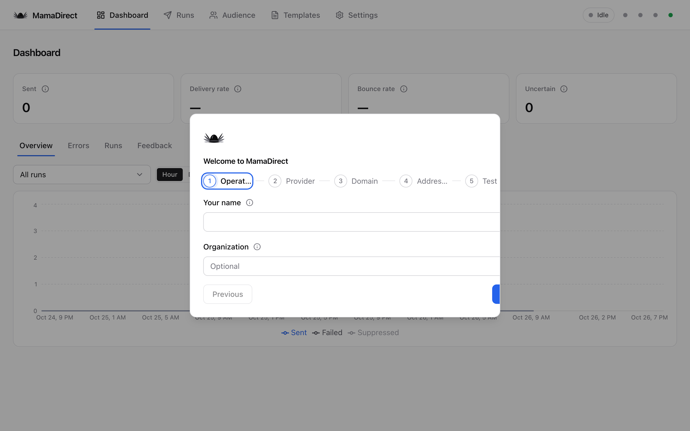
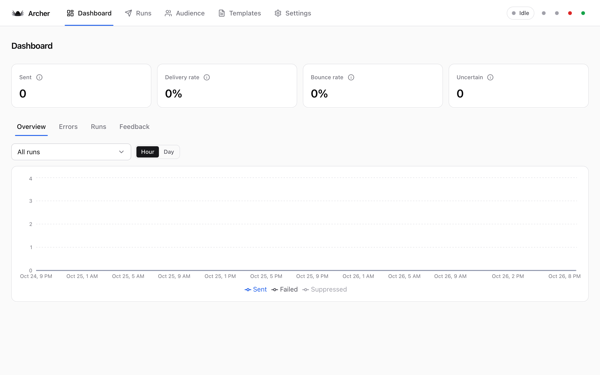
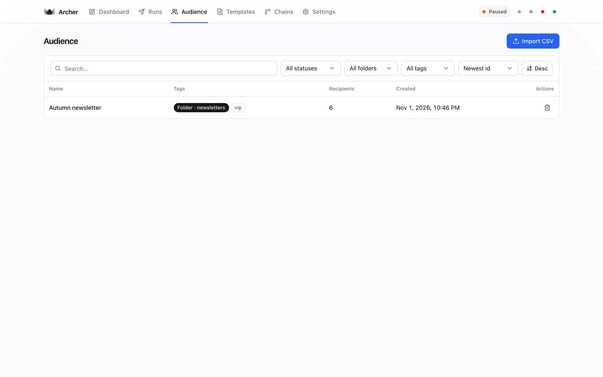
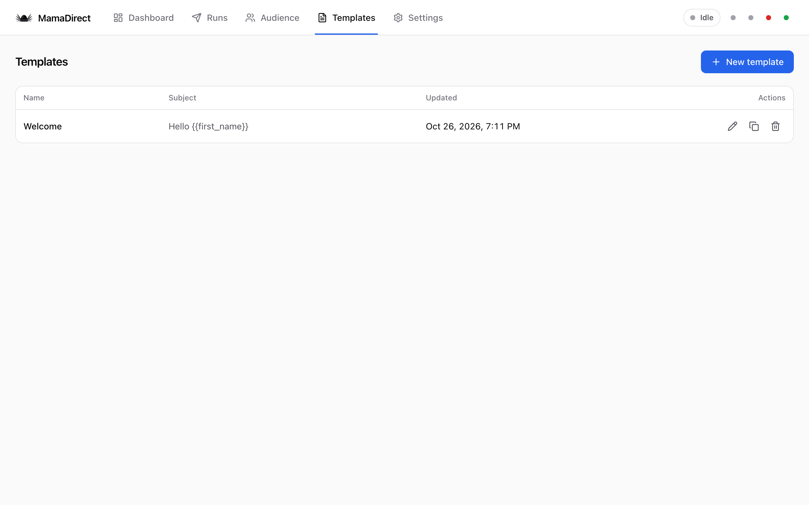
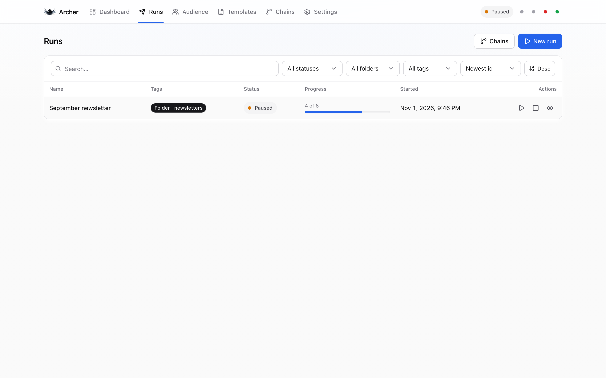
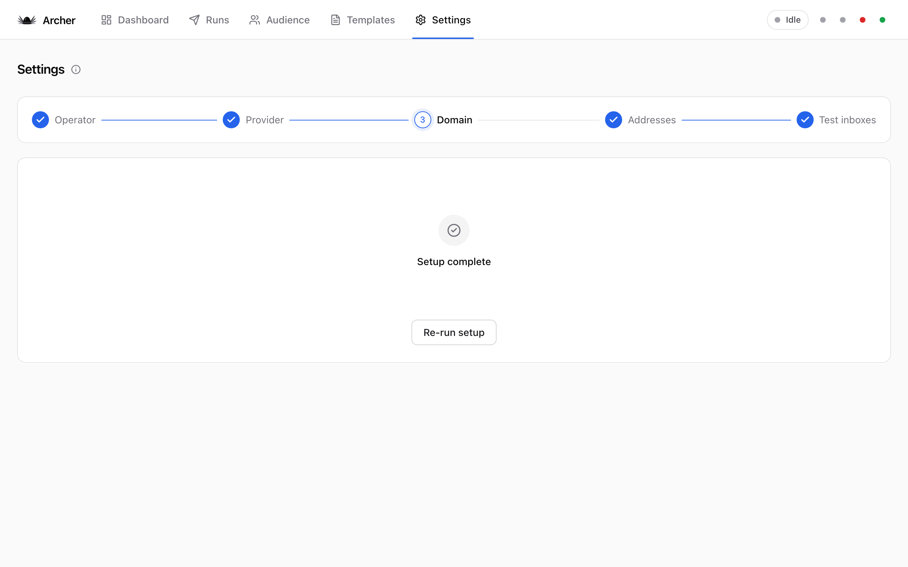
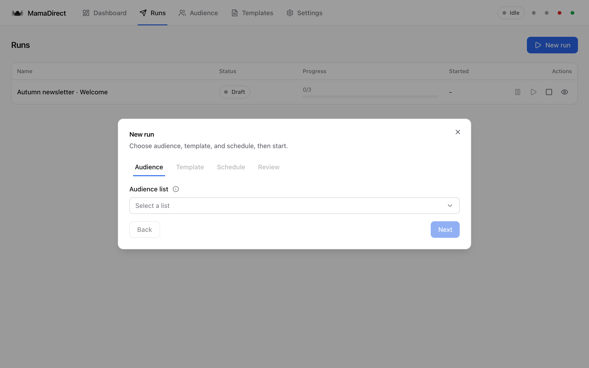
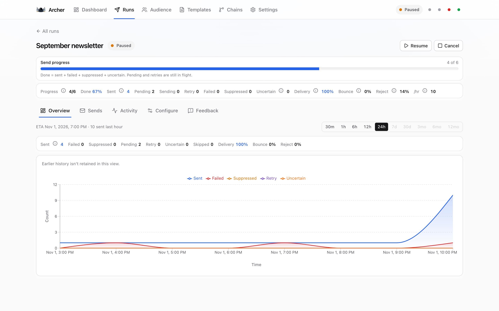

<p align="center">
  
</p>

<h1 align="center">Archer</h1>

<p align="center">
  <strong>Local-first bulk email for a domain you already own.</strong><br>
  Import a CSV, write HTML once, warm up safely, and send one personalized message at a time
  through Amazon SES or any SMTP provider — with unsubscribe, suppression, and hard stops built in.
  Your list never leaves this computer.
</p>

<p align="center">
  <a href="#why-people-use-it">Why</a> ·
  <a href="#real-use-cases">Use cases</a> ·
  <a href="#how-it-works">How</a> ·
  <a href="#security">Security</a> ·
  <a href="#install">Install</a> ·
  <a href="#screenshots">Screenshots</a>
</p>

---

## Why people use it

Hosted ESPs are great until you want the list on your disk, the SMTP keys write-only, and an honest
“why won’t this launch?” checklist. Archer is a **local Node app** (SQLite under `data/`) with a
React UI on `127.0.0.1` — not another cloud account for your audience.

| You want | Archer gives you |
|---|---|
| Keep PII off third-party servers | Audiences, templates, and runs stay in gitignored `data/` |
| SES or any SMTP | Required setup wizard + Settings columns that save independently |
| CAN-SPAM without drama | From name, postal address, unsubscribe mailbox, List-Unsubscribe, merge tags |
| Not melting a new domain | Warm-up, daily caps, send windows, bounce tripwire |
| Know why a run won’t start | Setup complete + launch gates (SMTP, DNS, compliance tags, test send) |
| Reuse setup | Save provider / sender / DNS / test inboxes once; re-run wizard anytime |

**Skip Archer** if you need multi-user orgs, a template marketplace, or guaranteed inbox placement.
We don’t fake those.

## Real use cases

- **Founder newsletter on a spare domain** — import the waitlist CSV, personalize with `{{first_name}}`,
  warm up over a week, pause anytime from the Runs table.
- **Agency client send on their SES** — configure SMTP once in Settings, keep the client list local,
  swap templates without re-entering credentials.
- **Product launch / waitlist drip** — guided CSV import (comma / semicolon / tab / headerless),
  folders + tags on lists and runs, chains when you need follow-ups.
- **Compliance-sensitive ops** — consent attestation on import, role-address filter, suppression list,
  uncertain sends never auto-resent.
- **Self-host on a laptop** — desktop launcher (`Archer.app` / `.cmd` / `.desktop`), doctor on start,
  backups under `data/backups/`.

## How it works

1. **Setup (required)** — operator → SES/SMTP → DNS (SPF/DKIM/DMARC) → from name / from / unsub /
   postal → test inboxes. The wizard stays open until you finish; other tabs stay locked. After that,
   **Settings** keeps each card editable with its own Save.
2. **Audience** — guided import (up to 200&nbsp;MB), drag-drop CSV/TSV, map the email column, attest
   consent, optional MX domain check. Streaming import + live progress; huge lists queue one at a time.
3. **Templates** — HTML + `{{unsubscribe_url}}`, `{{postal_address}}`, `{{first_name}}`, …
   Edit shows a live filled preview; View uses a server-side render with your sender config.
4. **Runs & Chains** — list + template + schedule (or a multi-step chain). Launch gates and finished
   setup must pass before send. Worker sends one message at a time.
5. **Dashboard** — dense metric bar (recipients, queue, delivery, bounce, reject, last send) plus
   charts that never invent zeros for rotated history.

Under the hood: Fastify + React + TanStack Query, session cookie + CSRF (`X-Archer`), self-healing
send loop, SSE live updates.

## Security

Local-first is the product.

- Binds to **`127.0.0.1` only**
- Session cookie + CSRF on every mutating route
- SMTP password **write-only** after save; secrets redacted from logs
- `UNSUB_SECRET` and `.env` are gitignored; `data/` never committed
- Do **not** expose the port to the public internet without a reverse proxy and auth you trust

## Install

**Needs:** Node.js ≥ 22.13, outbound SMTP (VPN is fine).

```bash
git clone https://github.com/ojs393/Archer.git Archer
cd Archer
npm run setup
npm start
```

Opens `http://127.0.0.1:5199`. First launch walks the wizard; Settings keeps the same configs editable
and re-saveable forever.

| Command | What it does |
|---|---|
| `npm run setup` | Install + `data/` + local `.env` secrets |
| `npm start` | Doctor + start (opens the UI) |
| `npm run seed:local` | Demo lists/runs into local `data/` (gitignored) |
| `npm run capture:screenshots` | Refresh `docs/screenshots/` (Playwright) |
| `npm run doctor` | Full health check / repair |
| `npm run selftest` | Fake SMTP end-to-end smoke |
| `npm test` | Unit + integration + web |
| `npm run build:web` | Production UI → `dist/web` |

## First send

1. Finish setup (SMTP test green; DNS may still be propagating).
2. **Audience** → Import — formats guide → drop file → map email → consent.
3. **Templates** → subject + HTML with compliance merge tags; check Preview.
4. **Runs** → New run → list, template, schedule → pass gates → Start.
5. Watch **Dashboard** / the run metric strip. Pause/Resume/Cancel as needed.

Before a real list: [`docs/PRELAUNCH.md`](docs/PRELAUNCH.md).

## Screenshots

Captured from a local demo instance (sample list + template; no live mail required).

| Setup | Dashboard |
|---|---|
|  |  |

| Audience | Templates |
|---|---|
|  |  |

| Runs | Settings |
|---|---|
|  |  |

<p align="center">
  
</p>

<p align="center">
  
</p>

## Layout

| Path | Role |
|---|---|
| `config/` | Vite, Vitest, Tailwind, TypeScript |
| `server/` | HTTP API, send worker, SQLite |
| `web/` | React UI |
| `scripts/` | setup, doctor, icons, screenshots |
| `tests/` | unit + integration |
| `docs/` | API, ops, screenshots |
| `data/` | Local runtime only (gitignored) |

## Desktop launcher

From setup (**Add to Desktop**) or **Settings → App**: macOS `Archer.app`, Windows `Archer.cmd`,
Linux `Archer.desktop`.

## Docs

- [`docs/api.md`](docs/api.md) — HTTP API
- [`docs/web.md`](docs/web.md) — UI conventions
- [`docs/operations.md`](docs/operations.md) — disk, backups, recycle
- [`docs/PRELAUNCH.md`](docs/PRELAUNCH.md) — checks before a real list

## License

Private repository. All rights reserved unless otherwise noted.
